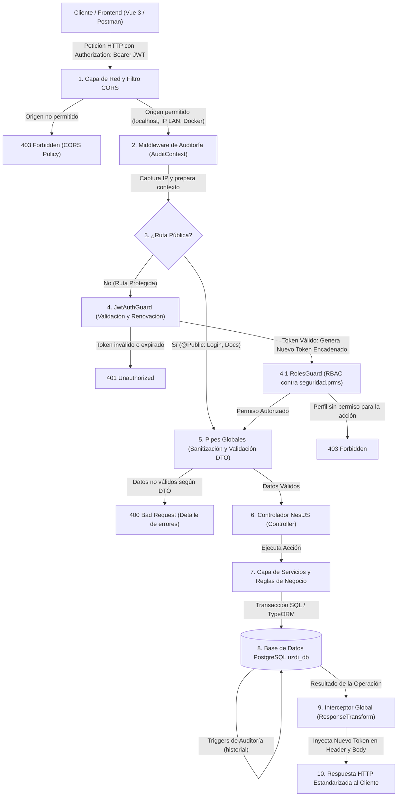
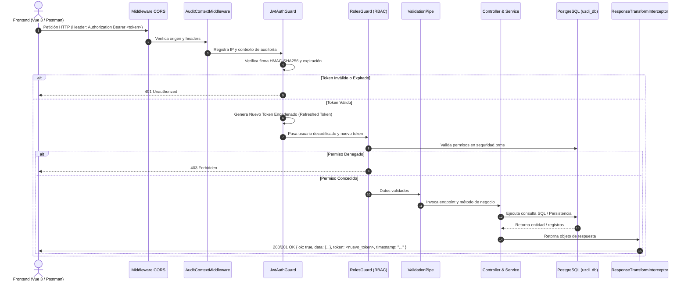
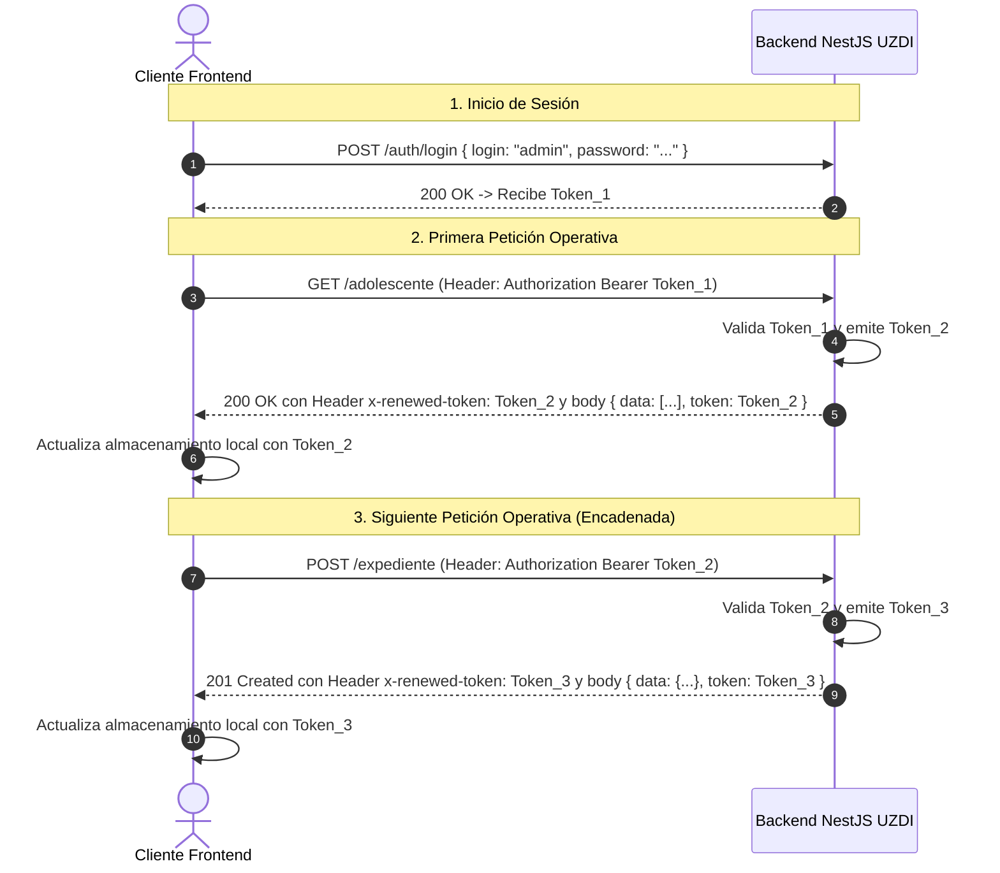

# Documento Técnico: Arquitectura de Seguridad, Pipeline y Persistencia UZDI

**Autor:** Equipo de Backend UZDI (Arquitectura & Seguridad Core)  
**Proyecto:** UZDI - Sistema de Gestión Integral de Medidas Socioeducativas (SNAI - PUCE)  
**Versión API:** 2.0  
**Fecha:** Noviembre 2026  

---

## 1. Justificación Arquitectónica: Modelo de Conexión a Base de Datos vs RBAC

Durante la revisión técnica se planteó la siguiente interrogante arquitectónica:
> *¿Por qué el backend utiliza una única conexión administrativa a PostgreSQL (`uzdi_user` o `postgres`) en lugar de crear un usuario de base de datos por cada usuario humano del sistema?*

### Fundamentos Técnicos:
1. **Connection Pooling y Escalabilidad:**
   - La arquitectura de NestJS con TypeORM maneja un grupo de conexiones concurrentes (*Pool de Conexiones*). Abrir una conexión TCP/TLS por cada usuario humano saturaría rápidamente los límites de memoria y conexiones simultáneas de PostgreSQL (`max_connections`).
2. **Desacoplamiento de Capas:**
   - En aplicaciones empresariales modernas, la autenticación y autorización se resuelven a nivel de la capa de aplicación (*Application-Level Authorization*). La base de datos almacena los permisos (`seguridad.prms`, `seguridad.prpf`), pero no gestiona sesiones ni tokens criptográficos.
3. **Auditoría Transaccional Contextual:**
   - Aunque la base de datos se conecta con un usuario central, las operaciones quedan auditadas con el ID del usuario real gracias a `AuditContextMiddleware` y a la variable de sesión PostgreSQL `SET LOCAL app.usuario_id`, registrando en `seguridad.historial` el usuario exacto, la IP y la máquina cliente.

---

## 2. Flujo de Atención a la Petición

*(Sección actualizada según observación de evaluación docente: presentación gráfica, visual y secuencial en lugar de una lista plana numerada).*

### 2.1 Diagrama Gráfico de Flujo de Atención



### 2.2 Diagrama de Secuencia del Procesamiento de Peticiones



---

## 3. Manejo y Documentación del JWT: Ciclo de Actualización Continua (Token Chaining)

El evaluador solicitó detallar el funcionamiento interno del JWT y la implementación del **ciclo de renovación continua (encadenamiento de tokens)**.

### 3.1 Estructura y Validación Criptográfica Interna
1. **Algoritmo de Firma:** HMAC SHA-256 (`HS256`).
2. **Secreto Institucional:** Almacenado en la variable de entorno `JWT_SECRET`.
3. **Payload Institucional:**
   ```json
   {
     "sub": 1,
     "username": "admin",
     "email": "admin@snai.gob.ec",
     "prfl_id": 1,
     "rol": "ADMINISTRADOR",
     "rol_codigo": "ADM",
     "sesion_id": 10,
     "iat": 1794617565,
     "exp": 1794646365
   }
   ```
4. **Verificación en cada Petición:**
   - `JwtAuthGuard` extrae la cabecera `Authorization: Bearer <token>`.
   - Ejecuta `jwtService.verifyAsync(token)` comprobando firma matemática y fecha `exp`.
   - Si el token ha sido alterado o expiró, rechaza de inmediato con `401 Unauthorized`.

### 3.2 Ciclo de Actualización Encadenada (Token Chaining)
Para evitar que la sesión del operador expire en medio de su jornada laboral mientras interactúa con el sistema, se implementó el patrón de **encadenamiento automático de token por solicitud**:



- **Mecanismos de Entrega:**
  1. **Cabecera HTTP:** `x-renewed-token` y `Authorization: Bearer <nuevo_token>`.
  2. **Cuerpo JSON:** `{ ok: true, data: {...}, token: "<nuevo_token>", timestamp: "..." }`.
  3. **CORS:** La propiedad `exposedHeaders: ['Authorization', 'x-renewed-token']` permite al frontend leer la cabecera en el navegador sin restricciones de seguridad.

---

## 4. Estándar Oficial de Respuestas JSON y Justificación del Campo `path`

### 4.1 Respuesta Exitosa (200 / 201 OK):
```json
{
  "ok": true,
  "message": "Operación realizada correctamente",
  "data": {
    "id": 1,
    "nombre": "Juan Carlos (Prueba)",
    "cedula": "0000000011",
    "estado": true
  },
  "token": "eyJhbGciOiJIUzI1NiIsInR5cCI6IkpXVCJ9...",
  "timestamp": "2026-11-23T20:00:00.000Z"
}
```

### 4.2 Respuesta de Error (400 / 401 / 403 / 404 / 500):
```json
{
  "ok": false,
  "statusCode": 400,
  "message": "Error de validación en la solicitud",
  "errors": [
    "cedula debe ser una cédula de 10 dígitos o un pasaporte alfanumérico"
  ],
  "path": "/api/v1/adolescente",
  "timestamp": "2026-11-23T20:00:00.000Z"
}
```

### 4.3 Justificación Técnica Formal del Campo `path`
El evaluador consultó por qué se retorna `path` en el cuerpo del error si ya viene en la URL de la petición.
* **Estándar Internacional RFC 7807 (Problem Details for HTTP APIs):** Especifica que los objetos de diagnóstico de error deben ser auto-contenidos, incluyendo el recurso URI origen de la falla (`instance` o `path`).
* **Desacoplamiento en SPAs y Frontend Asíncrono:** En aplicaciones cliente (Vue 3 / React / Angular), los interceptores globales de error (por ejemplo `axios.interceptors.response.use`) manejan las fallas de forma centralizada sin acoplamiento a la vista o componente que disparó la solicitud. Tener el campo `path` en el JSON permite a los servicios de logging, notificación (Toast) y telemetría (Sentry / Datadog) registrar con exactitud qué recurso falló sin tener que inspeccionar estructuras internas del objeto `AxiosError`.
* **Seguridad y Limpieza:** Para optimizar el tráfico, el campo `path` **solo se incluye en respuestas de error**, manteniéndose ausente en las respuestas exitosas para no redundar.

---

## 5. Configuración y Despliegue con Docker Multi-Contenedor

El sistema incluye despliegue automatizado multi-contenedor en Linux:

* **Contenedor 1 (`uzdi_postgres`):** Base de datos PostgreSQL 15 en el puerto host `5432:5432`.
* **Contenedor 2 (`uzdi_api`):** API REST NestJS en el puerto host `3000:3000`.

### Comandos de Despliegue en Servidor Linux:
```bash
# 1. Clonar el repositorio
git clone https://github.com/alex171215/uzdi-backend-p8.git
cd uzdi-backend-p8

# 2. Levantar los contenedores en segundo plano (compilación e inicio automático)
docker compose up --build -d

# 3. Comprobar que los contenedores estén en estado saludable (Up)
docker compose ps

# 4. Ver los logs de inicialización de la API en vivo
docker compose logs -f uzdi_backend
```

*Los datos de estructura (DDL v8), seguridad (RBAC), catálogos geográficos y los 5 registros completos de prueba se cargan automáticamente desde el directorio `db/` durante el primer arranque.*
