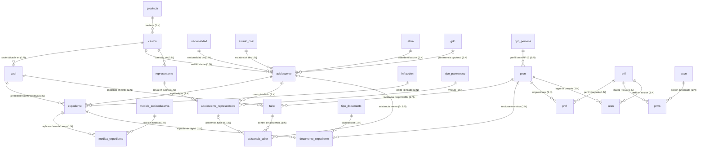

# 📐 ESPECIFICACIÓN TÉCNICA DEL DIAGRAMA ENTIDAD-RELACIÓN (DER) OFICIAL
## Sistema de Gestión Integral UZDI (SNAI – PUCE)
### Notación Formal, Modelo ER CAI y DDL Versión 8 — Metodología de Cátedra Ing. Guido

---

**Proyecto:** Sistema de Gestión Integral de Adolescentes Infractores — UZDI  
**Instituciones:** Servicio Nacional de Atención Integral a Personas Adultas Privadas de la Libertad y a Adolescentes Infractores (SNAI) / Pontificia Universidad Católica del Ecuador (PUCE)  
**Versión del Modelo de Datos:** DDL Versión 8 Oficial (`Back Ecologia (1).sql` + `db/02_seguridad_rbac.sql`)  
**Archivo Editable de Diagrama:** [`docs/diagramas/DER_OFICIAL_UZDI_SNAI_ING_GUIDO.drawio`](file:///c:/Users/lizzu/Documents/GitHub/uzdi-backend-p8/docs/diagramas/DER_OFICIAL_UZDI_SNAI_ING_GUIDO.drawio)  
**Referencia Cátedra:** Recurso EVA PUCE (`https://eva.puce.edu.ec/QUI-202602R/mod/resource/view.php?id=246449` / archivo `modelo ER CAI.jpeg`).

---

## 📌 1. INTRODUCCIÓN Y REGLAS DE MODELADO SEGÚN EL ING. GUIDO

En cumplimiento de las directrices metodológicas de cátedra impartidas por el Ing. Guido y la evolución del DDL v8, este documento formaliza el Diagrama Entidad-Relación oficial del sistema.

### Principios Fundamentales Aplicados:
1. **Atributos de Auditoría Obligatorios en TODAS las Tablas:**
   * `fcCrea TIMESTAMP NOT NULL DEFAULT NOW()`: Fecha y hora exacta de creación del registro.
   * `fcMod TIMESTAMP NOT NULL DEFAULT NOW()`: Fecha y hora de última modificación, actualizada automáticamente mediante el trigger `seguridad.fn_actualizar_fcmod()`.
2. **Estandarización del Estado Lógico:**
   * `estado CHAR(1) NOT NULL DEFAULT 'V' CHECK (estado IN ('V', 'F'))`: Garantiza borrado lógico institucional en todas las tablas sin pérdida histórica de información.
3. **Desacople CONA en Dominio Judicial:**
   * En versiones previas del modelo, `expediente` mantenía una clave foránea directa `mdso_id`, lo cual impedía asociar más de una medida socioeducativa por causa judicial.
   * En el DDL v8 se eliminó `mdso_id` de `expediente` y se creó la tabla relacional `adolescente.medida_expediente` con el atributo obligatorio `orden INT4` (según el Código de la Niñez y Adolescencia), permitiendo modelar medidas simultáneas (mismo orden) o sucesivas (distinto orden).
   * Se incorporó el atributo institucional `numero_causa VARCHAR(100)` con unicidad sobre expedientes activos.
4. **Recuadro de Seguridad ER CAI y Matriz RBAC:**
   * Mapeo riguroso de las entidades del recuadro inferior del diagrama ER CAI: `prsn` (persona/usuario), `prfl` (perfil), `accn` (acción operativa), `prms` (permiso perfil-acción), `sesn` (apertura y cierre de sesión) y `prpf` (asignación de perfiles a personas).

---

## 🗺️ 2. MAPA ARQUITECTÓNICO DEL DER EN 6 SUBSISTEMAS

---

## 📋 3. DICCIONARIO DE DATOS Y ESTRUCTURA DETALLADA POR TABLA

### 3.1. Dominio Judicial y Medidas CONA (`adolescente`)

#### Tabla `adolescente.expediente`
| Atributo | Tipo de Dato | Clave | Restricciones / Regla Cátedra |
|---|---|:---:|---|
| `expe_id` | `INT4` | **PK** | Serial autoincremental |
| `adlc_id` | `INT4` | **FK** | Referencia a `adolescente.adolescente` |
| `uzdi_id` | `INT4` | **FK** | Referencia a `estructura_institucional.uzdi` |
| `infc_id` | `INT4` | **FK** | Referencia a `adolescente.infraccion` |
| `numero_causa` | `VARCHAR(100)` | | Número único institucional (validado en activos) |
| `expeetps` | `VARCHAR(50)` | | Estado procesal (`En proceso`, `Atraso`, `Concluido`, etc.) |
| `expeobsr` | `TEXT` | | Observaciones jurídicas |
| `estado` | `CHAR(1)` | | `'V'` (activo) o `'F'` (inactivo) |
| `fcCrea` | `TIMESTAMP` | | Obligatorio: `DEFAULT NOW()` |
| `fcMod` | `TIMESTAMP` | | Obligatorio: Actualizado por trigger |

#### Tabla `adolescente.medida_expediente` *(Novedad DDL v8 CONA)*
| Atributo | Tipo de Dato | Clave | Restricciones / Regla Cátedra |
|---|---|:---:|---|
| `mdex_id` | `INT4` | **PK** | Serial autoincremental |
| `expe_id` | `INT4` | **FK** | Referencia a `adolescente.expediente` (ON DELETE CASCADE) |
| `mdso_id` | `INT4` | **FK** | Referencia a `adolescente.medida_socioeducativa` |
| `orden` | `INT4` | | **Obligatorio CONA:** `>= 1`. Orden cronológico o simultáneo |
| `fecha_inicio` | `DATE` | | Fecha de inicio de la medida |
| `fecha_fin` | `DATE` | | `CHECK (fecha_fin >= fecha_inicio)` |
| `estado_cumplimiento`| `VARCHAR(50)` | | `En proceso`, `Cumplida`, `Incumplida`, `Sustituida` |
| `observaciones` | `TEXT` | | Seguimiento judicial |
| `estado` | `CHAR(1)` | | `'V'` o `'F'` |
| `fcCrea` | `TIMESTAMP` | | Obligatorio: `DEFAULT NOW()` |
| `fcMod` | `TIMESTAMP` | | Obligatorio: Actualizado por trigger |

#### Tabla `adolescente.infraccion`
* Atributos: `infc_id` (PK), `infcnmbr`, `infcctgr`, `infcartc` (Art. CONA/COIP), `infcdscr`, `estado`, `fcCrea`, `fcMod`.

#### Tabla `adolescente.medida_socioeducativa`
* Atributos: `mdso_id` (PK), `mdsonmbr`, `mdsodrcn` (duración en meses), `mdsodscr`, `estado`, `fcCrea`, `fcMod`.

---

### 3.2. Recuadro de Seguridad ER CAI (`seguridad`)

* **`seguridad.tipo_persona`**: Catálogo base institucional (RF-12). `tppr_id` (PK), `tpprcdgo`, `tpprnmbr`, `estado`, `fcCrea`, `fcMod`.
* **`seguridad.prsn`**: Usuario institucional del sistema. `prsn_id` (PK), `tppr_id` (FK), `uzdi_id` (FK), `prsnnmbr`, `prsnapll`, `prsnmail`, `prsnlgin`, `prsnpswd` (bcrypt), `estado`, `fcCrea`, `fcMod`.
* **`seguridad.prfl`**: Perfiles institucionales (`ADM`, `LEGAL`, `CORD`, `TSOC`, `PSIC`, `EDUC`). `prfl_id` (PK), `prflcdgo`, `prflnmbr`, `estado`, `fcCrea`, `fcMod`.
* **`seguridad.prpf`**: Tabla asociativa Usuario ↔ Perfiles. `prpf_id` (PK), `prsn_id` (FK), `prfl_id` (FK), `estado`, `fcCrea`, `fcMod`.
* **`seguridad.accn`**: Acciones del sistema (`adolescente.consultar`, `expediente.crear`, etc.). `accn_id` (PK), `accnnmbr`, `accndscr`, `accnadbl`, `estado`, `fcCrea`, `fcMod`.
* **`seguridad.prms`**: Permisos asignados Perfil ↔ Acción. `prms_id` (PK), `prfl_id` (FK), `accn_id` (FK), `estado`, `fcCrea`, `fcMod`.
* **`seguridad.sesn`**: Sesiones y tokens activos. `sesn_id` (PK), `prsn_id` (FK), `prfl_id` (FK), `sesnfcin` (inicio), `sesnfcfn` (fin/logout), `estado`, `fcCrea`, `fcMod`.
* **`seguridad.historial`**: Auditoría inmutable alimentada por triggers. `hist_id` (PK), `hist_tabla`, `hist_registro_id`, `hist_usuario_id`, `hist_fecha`, `hist_accion`, `hist_estado_anterior`, `hist_estado_nuevo`.

---

### 3.3. Núcleo Sociodemográfico y Catálogos (`adolescente`)
* **`adolescente.adolescente`**: `adlc_id` (PK), `adlccdla` (UQ), `adlcnmbr`, `adlcapll`, `adlcfcna`, `adlcsexo`, `adlcfcin`, `nacn_id` (FK), `etcv_id` (FK), `etna_id` (FK), `cntn_id` (FK), `gdo_id` (FK opcional), `adlcnved`, `adlchjos`, `adlcrncd`, `adlchppl`, `estado`, `fcCrea`, `fcMod`.
* **Catálogos**: `nacionalidad`, `estado_civil`, `etnia`, `gdo` (todos con PK, nombre, `estado`, `fcCrea`, `fcMod`).

---

### 3.4. Estructura Geográfica (`estructura_institucional`)
* **`provincia`**: `prov_id` (PK), `provcdgo`, `provnmbr`, `estado`, `fcCrea`, `fcMod`.
* **`canton`**: `cntn_id` (PK), `prov_id` (FK), `cntncdgo`, `cntnnmbr`, `estado`, `fcCrea`, `fcMod`.
* **`uzdi`**: `uzdi_id` (PK), `cntn_id` (FK), `uzdinmbr`, `uzdizona`, `uzdidrcc`, `uzditlfn`, `uzdimail`, `estado`, `fcCrea`, `fcMod`.

---

### 3.5. Contexto Familiar (`contexto_familiar`)
* **`tipo_parentesco`**: `tprt_id` (PK), `tprtnmbr`, `estado`, `fcCrea`, `fcMod`.
* **`representante`**: `repr_id` (PK), `cntn_id` (FK), `reprcdla`, `reprnmbr`, `reprapll`, `reprtlfn`, `reprdrcc`, `estado`, `fcCrea`, `fcMod`.
* **`adolescente_representante`**: `adre_id` (PK), `adlc_id` (FK), `repr_id` (FK), `tprt_id` (FK), `adre_es_referente`, `adrefcin`, `adrefcfn`, `estado`, `fcCrea`, `fcMod`.

---

### 3.6. Talleres y Gestión Documental (`talleres_actividades`, `gestion_documental`)
* **`taller`**: `tall_id` (PK), `uzdi_id` (FK), `prsn_id` (FK), `tallnmbr`, `talltema`, `tallfcha`, `tallhrin`, `tallhrfn`, `estado`, `fcCrea`, `fcMod`.
* **`asistencia_taller`**: `astl_id` (PK), `tall_id` (FK), `tipo_asistente`, `adlc_id` (FK), `adre_id` (FK), `astlasst`, `estado`, `fcCrea`, `fcMod`.
* **`tipo_documento`**: `tpdc_id` (PK), `tpdcnmbr`, `tpdcdscr`, `estado`, `fcCrea`, `fcMod`.
* **`documento_expediente`**: `dcex_id` (PK), `expe_id` (FK), `prsn_id` (FK), `tpdc_id` (FK), `dcexnmro`, `dcexfcha`, `dcexemsr`, `dcexes_h`, `dcex_est`, `estado`, `fcCrea`, `fcMod`.

---

## 🎯 4. CÓMO VISUALIZAR Y EXPORTAR EL ARCHIVO EDITABLE
1. Abra el archivo [`docs/diagramas/DER_OFICIAL_UZDI_SNAI_ING_GUIDO.drawio`](file:///c:/Users/lizzu/Documents/GitHub/uzdi-backend-p8/docs/diagramas/DER_OFICIAL_UZDI_SNAI_ING_GUIDO.drawio) en cualquier navegador mediante [diagrams.net](https://app.diagrams.net) o en Visual Studio Code instalando la extensión *Draw.io Integration*.
2. Para exportar la versión formal de entrega:
   * Menú **Archivo > Exportar como > PNG** (marcar resolución 300 DPI y fondo transparente/blanco).
   * Menú **Archivo > Exportar como > PDF** (orientación horizontal, tamaño A3/A2 para diagramas integrales de base de datos).

