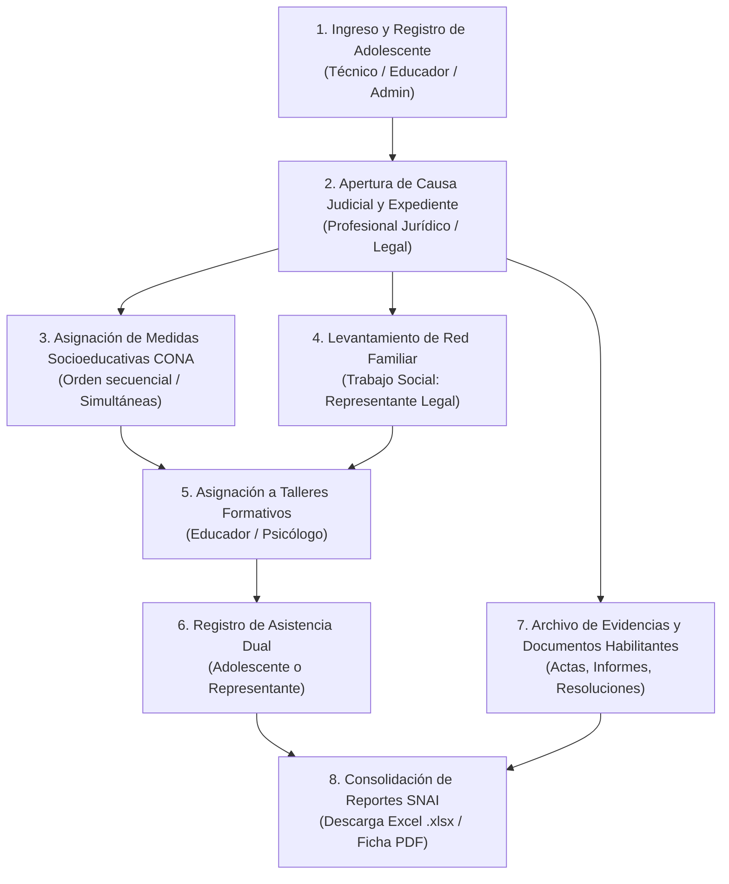

# 📘 MANUAL DE USUARIO FINAL Y GUÍA OPERATIVA INSTITUCIONAL
## Sistema de Gestión Integral de Adolescentes Infractores — UZDI
### Servicio Nacional de Atención Integral a Personas Adultas Privadas de la Libertad y a Adolescentes Infractores (SNAI) — Pontificia Universidad Católica del Ecuador (PUCE)

---

**Código del Documento:** SNAI-UZDI-MAN-001  
**Versión del Sistema:** 2.0 (Backend NestJS + TypeORM + DDL v8 / Frontend Vue 3)  
**Fecha de Emisión:** Noviembre 2026  
**Ámbito de Aplicación:** Unidades de Desarrollo Integral (UZDI) a nivel nacional y Dirección Nacional de Adolescentes Infractores (SNAI)  
**Marco Legal y Regulatorio:** Código Orgánico de la Niñez y Adolescencia (CONA), Código Orgánico Integral Penal (COIP) y Modelo de Atención Integral UZDI.

---

## 📑 ÍNDICE GENERAL

1. [Introducción y Propósitos Institucionales](#1-introducción-y-propósitos-institucionales)
2. [Arquitectura de Seguridad, Acceso y Gestión de Sesiones](#2-arquitectura-de-seguridad-acceso-y-gestión-de-sesiones)
3. [Matriz Operativa de Roles y Perfiles de Acceso](#3-matriz-operativa-de-roles-y-perfiles-de-acceso)
4. [Flujo Operativo Paso a Paso (Guía Práctica)](#4-flujo-operativo-paso-a-paso-guía-práctica)
   * 4.1. [Módulo 1: Registro Sociodemográfico del Adolescente](#41-módulo-1-registro-sociodemográfico-del-adolescente)
   * 4.2. [Módulo 2: Apertura y Control del Expediente Judicial (Causa y Medidas CONA)](#42-módulo-2-apertura-y-control-del-expediente-judicial-causa-y-medidas-cona)
   * 4.3. [Módulo 3: Contexto Familiar y Tutoría Legal](#43-módulo-3-contexto-familiar-y-tutoría-legal)
   * 4.4. [Módulo 4: Talleres Socioeducativos y Control de Asistencia](#44-módulo-4-talleres-socioeducativos-y-control-de-asistencia)
   * 4.5. [Módulo 5: Gestión Documental y Archivo Digital de Evidencias](#45-módulo-5-gestión-documental-y-archivo-digital-de-evidencias)
   * 4.6. [Módulo 6: Generación y Exportación de Reportes SNAI (Excel y PDF)](#46-módulo-6-generación-y-exportación-de-reportes-snai-excel-y-pdf)
5. [Catálogo de Mensajes del Sistema, Validaciones y Manejo de Errores](#5-catálogo-de-mensajes-del-sistema-validaciones-y-manejo-de-errores)
6. [Normas de Confidencialidad y Advertencias Institucionales](#6-normas-de-confidencialidad-y-advertencias-institucionales)
7. [Glosario de Términos y Soporte Técnico](#7-glosario-de-términos-y-soporte-técnico)

---

## 📌 1. INTRODUCCIÓN Y PROPÓSITOS INSTITUCIONALES

### 1.1. Contexto y Justificación
El **Sistema de Gestión Integral UZDI** es la plataforma informática oficial implementada para registrar, supervisar, intervenir y evaluar el cumplimiento de las medidas socioeducativas no privativas de libertad impuestas a adolescentes en conflicto con la ley penal en el Ecuador.

Desarrollado bajo convenio interinstitucional entre el **SNAI** y la **Pontificia Universidad Católica del Ecuador (PUCE)**, el sistema reemplaza el uso de registros dispersos en hojas de cálculo y expedientes físicos no centralizados, garantizando:
* **Trazabilidad estricta:** Registro de cada movimiento administrativo con usuario y fecha en auditoría inmutable (`seguridad.historial`).
* **Cumplimiento legal del CONA:** Gestión ordenada y secuencial de medidas socioeducativas (simultáneas o sucesivas).
* **Intervención interdisciplinaria:** Articulación en tiempo real entre los equipos Técnico, Jurídico, Psicológico, Trabajo Social y Educativo.
* **Seguridad y confidencialidad:** Protección de la identidad del menor infractor bajo estándares constitucionales.

### 1.2. Propósitos Principales del Sistema
1. **Centralización Sociodemográfica:** Custodiar el historial de vida, nivel educativo, salud y pertenencia a grupos vulnerables de los adolescentes.
2. **Control Procesal y Medidas:** Monitorear el estado procesal (`En proceso`, `Atraso`, `Incomparecencia`, `Concluido`, `Archivado`) y el cumplimiento de medidas socioeducativas.
3. **Fortalecimiento de la Red Familiar:** Vincular al tutor o representante legal activo, registrando su corresponsabilidad en el plan de medidas.
4. **Monitoreo de Talleres y Asistencia:** Registrar la participación tanto de adolescentes como de sus tutores en talleres formativos y psicoeducativos.
5. **Generación Automática de Reportes Oficiales:** Proveer al SNAI y a las autoridades judiciales estadísticas consolidadas en formatos interoperables (Excel y PDF).

### 1.3. Diagrama Entidad-Relación Oficial (Modelo CAI / UZDI)
El modelo físico relacional implementado en PostgreSQL (esquemas `seguridad`, `adolescente`, `contexto_familiar`, `estructura_institucional`, `gestion_documental` y `talleres_actividades`) se encuentra respaldado de forma íntegra en la documentación técnica del repositorio:
* **Archivo gráfico de arquitectura:** [DIAGRAMA_ENTIDAD_RELACION_CAI_UZDI.jpeg](file:///c:/Users/ASUS/Documents/6to%20Semestre/Ecolog%C3%ADa%20Integral/RDA2/teoria/UZDI_BACK/UZDI_BACK/docs/DIAGRAMA_ENTIDAD_RELACION_CAI_UZDI.jpeg)
* **Script DDL v8 unificado:** `Back Ecologia (1).sql`

---

## 🔐 2. ARQUITECTURA DE SEGURIDAD, ACCESO Y GESTIÓN DE SESIONES

El sistema opera bajo una arquitectura de seguridad criptográfica basada en tokens **JWT (JSON Web Token)** de corta duración (8 horas), control de acceso por perfiles (**RBAC**) y registro transaccional de apertura y cierre de sesiones.

### 2.1. Requisitos de Acceso
* **Dispositivo:** Computadora institucional conectada a la Red Local (LAN) o Red Gubernamental VPN.
* **Navegador Recomendado:** Google Chrome 110+, Mozilla Firefox 110+, Microsoft Edge 110+.
* **Dirección de Acceso al Frontend:** `http://localhost:5173` o la dirección IP asignada por la coordinación (ej. `http://192.168.100.x:5173`).

### 2.2. Inicio de Sesión (Login)

```
┌─────────────────────────────────────────────────────────────┐
│                 SNAI — SISTEMA UZDI v2.0                    │
│                                                             │
│  Usuario / Login:     [ juan.perez                     ]    │
│  Contraseña:          [ •••••••••••••••••              ]    │
│                                                             │
│                      [ INICIAR SESIÓN ]                     │
└─────────────────────────────────────────────────────────────┘
```

1. Ingrese su **Nombre de Usuario** institucional asignado por el Administrador.
2. Digite su **Contraseña personal**.
3. Haga clic en **INICIAR SESIÓN**.
4. **Validación tras bambalinas:** El sistema autentica las credenciales con hash `bcrypt`, genera el token criptográfico JWT e inserta una sesión activa en `seguridad.sesn` registrando la fecha/hora de ingreso (`sesnfcin`).
5. Si las credenciales son correctas, el sistema lo redirecciona automáticamente al Panel Principal correspondiente a su rol.

> [!IMPORTANT]
> **Caducidad de Token:** Si la sesión permanece inactiva por más de 8 horas, el token expirará automáticamente por seguridad institucional. El sistema responderá con `401 Unauthorized` y solicitará ingresar nuevamente sus credenciales.

### 2.3. Cambio Periódico de Contraseña
Por directriz institucional del SNAI, todo usuario debe cambiar su clave provisional en su primer acceso:
1. Acceda al menú superior derecho y seleccione **Seguridad > Cambiar Contraseña**.
2. Ingrese su contraseña actual.
3. Ingrese su nueva contraseña (mínimo 8 caracteres, al menos una mayúscula, un número y un símbolo especial).
4. Confirme la nueva contraseña y presione **Guardar**.

### 2.4. Cierre de Sesión Seguro (Logout)
Al finalizar su jornada laboral:
1. Haga clic en su nombre en la esquina superior derecha.
2. Seleccione **Cerrar Sesión**.
3. El sistema invocará `POST /api/v1/auth/logout`, actualizando la fecha y hora de fin de sesión (`sesnfcfn`) en la base de datos e invalidando el token JWT en el cliente.

---

## 👥 3. MATRIZ OPERATIVA DE ROLES Y PERFILES DE ACCESO

Cada usuario tiene asignado un perfil institucional con competencias específicas en la base de datos (`seguridad.prfl` y `seguridad.prms`):

| Código Perfil | Perfil Institucional | Responsabilidades Principales | Módulos Autorizados |
|:---:|:---|:---|:---|
| **`ADM`** | **Administrador del Sistema** | Gestión de usuarios, perfiles, acciones, catálogos paramétricos, auditoría global y mantenimiento técnico. | Acceso total transversal |
| **`CORD`** | **Coordinador Zonal / Director UZDI** | Asignación de casos, supervisión de equipos técnicos, aprobación de informes y descarga de reportes consolidados SNAI. | Todos los módulos (Lectura y Aprobación), Reportes |
| **`LEGAL` / `JUEZ`** | **Profesional Jurídico / Analista Legal** | Apertura de causas judiciales (`numero_causa`), tipificación de infracciones, asignación secuencial de medidas CONA y archivo digital de expedientes. | Adolescentes, Expedientes, Medidas, Gestión Documental, Reportes |
| **`TSOC`** | **Trabajador Social** | Levantamiento de la red familiar, vinculación de representantes y tutores legales, visitas domiciliarias y fichas de contexto familiar. | Adolescentes, Contexto Familiar, Asistencias, Documentos |
| **`PSIC`** | **Psicólogo Clínico** | Evaluaciones psicológicas, planes de intervención socioemocional, facilitación de talleres y seguimiento de medidas terapéuticas. | Adolescentes, Expedientes, Talleres, Asistencias |
| **`EDUC`** | **Educador Social / Facilitador** | Ejecución de talleres psicoeducativos, control de asistencia dual (menor y representante) y seguimiento pedagógico. | Adolescentes, Talleres, Asistencia a Talleres |
| **`CONS`** | **Auditor / Consulta SNAI** | Consulta de expedientes, verificación estadística e inspección de reportes de cumplimiento sin privilegios de edición. | Solo lectura en Adolescentes, Expedientes y Reportes |

---

## 🚀 4. FLUJO OPERATIVO PASO A PASO (GUÍA PRÁCTICA)

A continuación se detalla el ciclo integral de atención de un adolescente en la UZDI:



---

### 4.1. Módulo 1: Registro Sociodemográfico del Adolescente

#### Mockup Visual de la Pantalla:
```
┌────────────────────────────────────────────────────────────────────────────────────────┐
│  SNAI - SISTEMA UZDI  │  Adolescentes > Registro de Nuevo Adolescente                  │
├────────────────────────────────────────────────────────────────────────────────────────┤
│  FICHA DE INGRESO SOCIODEMOGRÁFICO                                                     │
│                                                                                        │
│  [ DATOS PERSONALES ] ───────────────────────────────────────────────────────────────   │
│   Cédula / Identificación: [* 1723456789        ]  [🔍 Verificar Duplicidad]           │
│   Nombres:                 [* Carlos Andrés     ]  Apellidos: [* Pérez Gómez       ]   │
│   Fecha de Nacimiento:     [* 2008-05-14 📅     ]  Sexo:      [* [ M - Masculino ▼]]   │
│   Nivel Educativo:         [ Educación General Básica Superior                     ]   │
│                                                                                        │
│  [ SITUACIÓN SOCIOFAMILIAR Y VULNERABILIDAD ] ──────────────────────────────────────   │
│   Nacionalidad: [* [ Ecuatoriana        ▼]]   Etnia:        [* [ Mestizo/a       ▼]]   │
│   Estado Civil: [* [ Soltero/a          ▼]]   Cantón Res.:  [* [ Quito           ▼]]   │
│   Hijos:        [ 0                     ]   Reincidente:  [ ] Sí                       │
│   Hijo de PPL:  [ ] Sí                      GDO Vinculado:[ [ Ninguno / No id.   ▼]]   │
│                                                                                        │
│  [ DATOS DE INGRESO INSTITUCIONAL ] ────────────────────────────────────────────────   │
│   Fecha de Ingreso UZDI: [* 2026-02-01 📅       ]                                      │
│   Observaciones Generales:                                                             │
│   [ Reside con abuela materna en sector Quitumbe. Buena disposición al proceso.    ]   │
│                                                                                        │
│                                [ CANCELAR ]    [💾 GUARDAR ADOLESCENTE]                │
└────────────────────────────────────────────────────────────────────────────────────────┘
```

#### Propósito:
Ingresar formalmente al adolescente derivado por la autoridad judicial a la sede UZDI.

#### Pasos a Seguir:
1. Diríjase al menú lateral y seleccione **Adolescentes > Nuevo Registro**.
2. **Búsqueda Previa:** Ingrese el número de cédula en el buscador rápido. Si el adolescente ya fue registrado con anterioridad, el sistema alertará su existencia para evitar duplicados.
3. Complete los campos requeridos:
   * **Cédula / Documento:** 10 dígitos para cédula ecuatoriana o entre 6 y 20 caracteres alfanuméricos para pasaporte extranjero.
   * **Nombres y Apellidos:** Conforme constan en la cédula de identidad o partida de nacimiento.
   * **Fecha de Nacimiento:** Seleccione en el calendario (el sistema calcula automáticamente la edad y valida que esté dentro del rango de adolescencia legal).
   * **Sexo:** `M` (Masculino), `F` (Femenino), `O` (Otro).
   * **Datos Sociodemográficos:** Seleccione de las listas desplegables:
     * *Etnia:* Mestizo, Indígena, Afroecuatoriano, Blanco, Montubio, etc.
     * *Nacionalidad:* Ecuatoriana, Colombiana, Venezolana, etc.
     * *Estado Civil:* Soltero, Unión de hecho, Casado.
     * *Cantón de Residencia:* Filtrado por provincia.
     * *Hijos:* Número de dependientes (0 si no tiene).
     * *Reincidencia:* Marcar la casilla únicamente si registra antecedentes previos.
     * *GDO (Grupo de Delincuencia Organizada):* Seleccionar del catálogo oficial si existe presunción o vinculación tipificada (o *Ninguno*).
4. Haga clic en **Guardar Adolescente**.
5. El sistema responderá:  
   `{ "ok": true, "message": "Operación realizada correctamente", "data": { "id": 15, "nombre": "...", ... } }`.

> [!TIP]
> **Búsqueda Rápida en Tiempo Real:** En la lista general de adolescentes, puede utilizar la barra de búsqueda superior para filtrar al instante por nombre, apellido o número de cédula sin recargar la página gracias al endpoint `GET /api/v1/adolescente/search?q=...`.

---

### 4.2. Módulo 2: Apertura y Control del Expediente Judicial (Causa y Medidas CONA)

#### Mockup Visual de la Pantalla:
```
┌────────────────────────────────────────────────────────────────────────────────────────┐
│  SNAI - SISTEMA UZDI  │  Adolescentes > Carlos Pérez > Expedientes Judiciales          │
├────────────────────────────────────────────────────────────────────────────────────────┤
│  EXPEDIENTE JUDICIAL: CAUSA N° EXP-2026-0042            [ Estado: ● En proceso ]       │
│                                                                                        │
│  Sede UZDI: UZDI Pichincha - Centro Norte      Infracción: Robo simple (Art. 189 COIP) │
│  Adolescente: Carlos Andrés Pérez Gómez        Cédula: 1723456789                      │
│                                                                                        │
│  [ MEDIDAS SOCIOEDUCATIVAS ASIGNADAS (CONA) ]            [+ AGREGAR MEDIDA]            │
│  ┌──────┬───────────────────────────────┬────────────┬────────────┬─────────────┬─────┐│
│  │Orden │ Medida Socioeducativa         │ F. Inicio  │ F. Fin     │ Cumplimiento│Act. ││
│  ├──────┼───────────────────────────────┼────────────┼────────────┼─────────────┼─────┤│
│  │  1   │ Amonestación e imp. de reglas │ 2026-02-15 │ 2026-08-15 │ Cumpliendo  │[✏️] ││
│  │  1   │ Orientación y apoyo familiar  │ 2026-02-15 │ 2026-08-15 │ Cumpliendo  │[✏️] ││
│  │  2   │ Servicio a la comunidad (60h) │ 2026-08-16 │ 2027-02-16 │ Pendiente   │[✏️] ││
│  └──────┴───────────────────────────────┴────────────┴────────────┴─────────────┴─────┘│
│  * Nota CONA: Medidas con igual orden (1) se ejecutan de manera simultánea.            │
│                                                                                        │
│  [ FORMULARIO MODAL: NUEVA MEDIDA SOCIOEDUCATIVA ]                                     │
│   Medida CONA:    [* [ Amonestación e imposición de reglas de conducta          ▼]]    │
│   Orden Mandato:  [* [ 1 ] (Mismo orden = Simultánea | Diferente = Sucesiva)          ]│
│   Fecha Inicio:   [* 2026-02-15 📅             ]  Fecha Fin: [ 2026-08-15 📅         ] │
│   Estado Inicial: [* [ Cumpliendo             ▼]]                                      │
│                                                                                        │
│                                [ CANCELAR ]    [💾 REGISTRAR MEDIDA]                   │
└────────────────────────────────────────────────────────────────────────────────────────┘
```

#### Propósito:
Vincular al adolescente con el proceso legal emanado de la Unidad Judicial, identificando el delito y ordenando las medidas socioeducativas.

#### Pasos a Seguir:
1. En la ficha del adolescente, seleccione la pestaña **Expedientes Judiciales** y presione **Abrir Nueva Causa**.
2. **Datos de la Causa:**
   * **Número de Causa:** Ingrese el número judicial oficial del sistema SATJE (ej. `18201-2026-00451`). Este campo es validado como único en el sistema.
   * **Sede UZDI:** Seleccione la oficina zonal que tiene a cargo el expediente.
   * **Infracción / Delito:** Seleccione del catálogo tipificado (ej. *Robo con fuerza*, *Tenencia no autorizada*, *Lesiones*).
   * **Estado Procesal:** Seleccione el estado inicial (por defecto *En proceso*).
3. Presione **Crear Expediente**.
4. **Asignación de Medidas Socioeducativas (`MedidaExpediente`):**
   * Dentro del expediente creado, presione **Agregar Medida Socioeducativa**.
   * **Tipo de Medida:** Seleccione del catálogo (ej. *Amonestación*, *Imposición de reglas de conducta*, *Orientación y apoyo familiar*, *Servicio a la comunidad*, *Libertad asistida*).
   * **Campo Orden (Mandato CONA):**
     * Si las medidas deben ejecutarse una tras otra (sucesivas), asígneles órdenes distintos: `1`, `2`, `3`.
     * Si deben ejecutarse al mismo tiempo (simultáneas), asígneles el **mismo número de orden** (ej. Medida A con orden `1` y Medida B con orden `1`).
   * **Fecha de Inicio y Fecha Fin:** Plazo legal establecido por el juez de la causa.
   * **Estado de Cumplimiento:** Inicialmente *En proceso* (actualizable posteriormente a *Cumplida*, *Incumplida*, *Sustituida* o *Suspendida*).
5. Presione **Guardar Medida**.

---

### 4.3. Módulo 3: Contexto Familiar y Tutoría Legal

#### Mockup Visual de la Pantalla:
```
┌────────────────────────────────────────────────────────────────────────────────────────┐
│  SNAI - SISTEMA UZDI  │  Adolescentes > Carlos Pérez > Red Familiar y Tutores          │
├────────────────────────────────────────────────────────────────────────────────────────┤
│  NÚCLEO FAMILIAR Y TUTORES VINCULADOS                   [+ VINCULAR REPRESENTANTE]     │
│                                                                                        │
│  ┌──────────────────────────────────────────────────────────────────────────────────┐  │
│  │ 👤 María Elena Gómez Morales (C.I. 1801234567)          [⭐ REFERENTE PRINCIPAL ] │  │
│  │ Parentesco: Abuela materna       Teléfono: 0991234567    Cantón: Quito           │  │
│  │ Dirección:  Av. Ajaví y Cardenal de la Torre             Desde: 2026-02-01       │  │
│  │ Estado:     Activo / Comparece a citas institucionales   [✏️ Editar]  [❌ Desvinc.]│  │
│  └──────────────────────────────────────────────────────────────────────────────────┘  │
│                                                                                        │
│  [ MODAL: VINCULAR REPRESENTANTE AL ADOLESCENTE ]                                      │
│   Buscar Familiar: [* [ 1801234567 - María Elena Gómez Morales                  ▼]]    │
│   Parentesco CONA: [* [ Abuela/o                                                ▼]]    │
│   Referente:       [X] Marcar como Representante Legal / Tutor Principal               │
│   Fecha Inicio:    [* 2026-02-01 📅             ]                                      │
│                                                                                        │
│                                [ CANCELAR ]    [💾 GUARDAR VÍNCULO]                    │
└────────────────────────────────────────────────────────────────────────────────────────┘
```

#### Propósito:
Registrar a los padres, familiares o tutores legales responsables de velar por el cumplimiento del proceso y acompañar al adolescente.

#### Pasos a Seguir:
1. Acceda al menú **Red Familiar > Representantes**.
2. Para registrar un nuevo familiar o tutor, haga clic en **Nuevo Representante**:
   * Ingrese Cédula, Nombres, Apellidos, Teléfono de contacto, Dirección domiciliaria y Cantón.
   * Presione **Registrar Representante**.
3. **Vinculación con el Adolescente (`adolescente_representante`):**
   * En la ficha del adolescente, seleccione la pestaña **Núcleo Familiar** y presione **Vincular Familiar / Tutor**.
   * Seleccione el representante previamente creado.
   * **Tipo de Parentesco:** Seleccione de la lista (Madre, Padre, Tío/a, Abuelo/a, Hermano/a mayor de edad, Tutor designado judicialmente).
   * **Referente Principal:** Marque esta casilla si la persona es quien acude a las citaciones, asiste a las terapias y responde legalmente ante la UZDI.
   * **Fechas de Vigencia:** Ingrese la fecha de inicio del acompañamiento.
4. Presione **Guardar Vínculo Familiar**.

---

### 4.4. Módulo 4: Talleres Socioeducativos y Control de Asistencia

#### Mockup Visual de la Pantalla:
```
┌────────────────────────────────────────────────────────────────────────────────────────┐
│  SNAI - SISTEMA UZDI  │  Talleres > Taller: Manejo del Estrés y Asertividad            │
├────────────────────────────────────────────────────────────────────────────────────────┤
│  FICHA DEL TALLER: "Manejo del Estrés y Asertividad"            [ Estado: ● En Curso ] │
│  Responsable: Lic. Marco Proaño (Psicólogo)     Sede: UZDI Pichincha - Centro Norte    │
│  Fecha: 2026-03-10  |  Horario: 09:00 a 11:00  |  Asistentes Registrados: 12           │
│                                                                                        │
│  [ REGISTRO DE ASISTENCIA DUAL - REGLA INSTITUCIONAL ]                                 │
│  Tipo de Asistente:  (●) Adolescente Infractor      ( ) Representante Legal / Tutor    │
│                                                                                        │
│  ┌─ Si seleccionó: Adolescente Infractor ───────────────────────────────────────────┐  │
│  │ Adolescente: [* [ 15 - Carlos Andrés Pérez Gómez (C.I. 1723456789)           ▼]] │  │
│  │ Tutor Legal: [ BLOQUEADO / DESHABILITADO AUTOMÁTICAMENTE                       ] │  │
│  │ Asistencia:  [X] Asistió puntualmente                                            │  │
│  │ Notas:       [ Participación activa en la dinámica de grupos.                  ] │  │
│  └──────────────────────────────────────────────────────────────────────────────────┘  │
│                                                                                        │
│  LISTA DE ASISTENCIA CONSOLIDADA DEL TALLER:                                           │
│  ┌──────┬──────────────────────┬───────────────┬────────────┬─────────────┬───────────┐│
│  │ Tipo │ Nombre Asistente     │ Cédula        │ Asistió    │ Observación │ Operación ││
│  ├──────┼──────────────────────┼───────────────┼────────────┼─────────────┼───────────┤│
│  │ Adlc │ Carlos Pérez Gómez   │ 1723456789    │ [X] Sí     │ Participó   │ [✏️] [🗑️] ││
│  │ Repr │ María Elena Gómez    │ 1801234567    │ [X] Sí     │ Acompañante │ [✏️] [🗑️] ││
│  └──────┴──────────────────────┴───────────────┴────────────┴─────────────┴───────────┘│
│                                                                                        │
│                                [ CANCELAR ]    [💾 REGISTRAR ASISTENCIA]               │
└────────────────────────────────────────────────────────────────────────────────────────┘
```

#### Propósito:
Planificar actividades grupales y registrar de forma diferenciada la asistencia del menor o de su representante.

#### Pasos a Seguir:

##### Paso 4.4.1. Planificación del Taller:
1. Ingrese a **Talleres y Actividades > Nuevo Taller**.
2. Complete la ficha técnica:
   * **Nombre y Tema:** Ej. *Taller de Habilidades para la Vida: Resolución Asertiva de Conflictos*.
   * **Objetivo:** Descripción del resultado esperado en los asistentes.
   * **Fecha y Horario:** Ingrese la fecha del taller, Hora de Inicio (ej. `09:00`) y Hora de Fin (ej. `11:00`). El sistema valida automáticamente que la hora de fin sea posterior a la de inicio.
   * **Profesional Responsable:** Seleccione al psicólogo o educador facilitador.
   * **Sede UZDI:** Seleccione la sede donde se impartirá.
3. Presione **Publicar Taller**.

##### Paso 4.4.2. Registro de Asistencia (Restricción Institucional Dual):
1. Ingrese al detalle del taller y presione **Tomar Asistencia**.
2. **Selección del Tipo de Asistente:**
   * **Opción A: Asistencia del Adolescente:**
     * Seleccione *Tipo de Asistente: Adolescente*.
     * Seleccione al adolescente de la lista. (El campo de representante queda automáticamente bloqueado).
     * Marque la casilla **Asistió** y agregue observaciones de participación.
   * **Opción B: Asistencia del Representante Legal:**
     * Seleccione *Tipo de Asistente: Representante*.
     * Seleccione al tutor vinculado al adolescente. (El campo de adolescente queda automáticamente bloqueado).
     * Marque la casilla **Asistió** y registre las notas relevantes.
3. Presione **Guardar Asistencia**.

> [!WARNING]
> **Regla de Negocio del Sistema:** La base de datos rechaza cualquier registro donde se intente enviar simultáneamente un adolescente y un representante, o donde no se envíe ninguno (`chk_asistencia_taller_asistente`). La interfaz garantiza esta exclusividad automáticamente.

---

### 4.5. Módulo 5: Gestión Documental y Archivo Digital de Evidencias

#### Mockup Visual de la Pantalla:
```
┌────────────────────────────────────────────────────────────────────────────────────────┐
│  SNAI - SISTEMA UZDI  │  Expedientes > EXP-2026-0042 > Repositorio Documental          │
├────────────────────────────────────────────────────────────────────────────────────────┤
│  DOCUMENTACIÓN DEL EXPEDIENTE                           [📤 ADJUNTAR NUEVO DOCUMENTO]  │
│                                                                                        │
│  ┌──────────────────────────────────────────────────────────────────────────────────┐  │
│  │ 📁 Arrastre y suelte aquí los archivos PDF/Imágenes o haga clic para examinar    │  │
│  │ Tipos soportados: PDF, JPG, PNG (Máx. 10MB por archivo)                          │  │
│  └──────────────────────────────────────────────────────────────────────────────────┘  │
│                                                                                        │
│  DOCUMENTOS REGISTRADOS:                                                               │
│  ┌────┬───────────────────────┬────────────────┬─────────────┬────────────┬───────────┐│
│  │ N° │ Tipo Documento        │ N° Oficio/Doc. │ Habilitante │ Estado     │ Acciones  ││
│  ├────┼───────────────────────┼────────────────┼─────────────┼────────────┼───────────┤│
│  │ 1  │ Resolución judicial   │ RES-2026-089-J │ [⭐ SÍ]     │ Verificado │ [👁️][⬇️]  ││
│  │ 2  │ Informe técnico       │ INF-TSOC-012   │ [   NO]     │ Recibido   │ [👁️][⬇️]  ││
│  │ 3  │ Acta de comparecencia │ ACT-COMP-004   │ [⭐ SÍ]     │ Verificado │ [👁️][⬇️]  ││
│  └────┴───────────────────────┴────────────────┴─────────────┴────────────┴───────────┘│
│                                                                                        │
│  [ MODAL: REGISTRO METADATOS DEL DOCUMENTO ]                                           │
│   Tipo Doc:     [* [ Resolución judicial                                        ▼]]    │
│   N° Oficio:    [* RES-2026-089-J            ]  Emisor: [ Unidad Judicial Familia  ]   │
│   Habilitante:  [X] Es requisito legal indispensable para culminación de la causa      │
│   Estado:       [* [ Verificado             ▼]]                                        │
│                                [ CANCELAR ]    [💾 GUARDAR DOCUMENTO]                  │
└────────────────────────────────────────────────────────────────────────────────────────┘
```

#### Propósito:
Adjuntar respaldos, resoluciones judiciales, oficios, valoraciones psicológicas e informes de cumplimiento de medidas a cada expediente.

#### Pasos a Seguir:
1. Ingrese al expediente judicial del adolescente y seleccione la pestaña **Documentos Adjuntos**.
2. Presione **Adjuntar Documento**:
   * **Tipo de Documento:** Seleccione del catálogo (ej. *Resolución Judicial*, *Ficha Psicológica*, *Informe Social*, *Acta de Compromiso*, *Certificado de Asistencia*).
   * **Número de Oficio / Documento:** Identificador oficial (ej. *OF-SNAI-UZDI-2026-089*).
   * **Emisor:** Juzgado, UZDI, Unidad Educativa o Centro de Salud.
   * **Documento Habilitante:** Marque la casilla si este documento es un requisito obligatorio legal para el cierre de la causa.
   * **Estado del Trámite:** Seleccione entre *Pendiente*, *Recibido*, *Verificado*, *No aplica* o *Rechazado*.
   * **Observaciones:** Resumen del contenido del documento.
3. Presione **Guardar Documento en Expediente**.

---

### 4.6. Módulo 6: Generación y Exportación de Reportes SNAI (Excel y PDF)

#### Mockup Visual de la Pantalla:
```
┌────────────────────────────────────────────────────────────────────────────────────────┐
│  SNAI - SISTEMA UZDI  │  Reportes Oficiales Institucionales                            │
├────────────────────────────────────────────────────────────────────────────────────────┤
│  CONSOLIDADOS Y EXPORTACIÓN DE DATOS PROCESALES                                        │
│                                                                                        │
│  [ CRITERIOS DE FILTRADO ] ──────────────────────────────────────────────────────────  │
│   Provincia:  [ [ Pichincha      ▼]]   Cantón:    [ [ Quito          ▼]]               │
│   Sede UZDI:  [ [ UZDI Pichincha - Centro Norte ▼]]  Estado: [ [ En proceso ▼]]        │
│                                                                                        │
│   ACCIONES DE EXPORTACIÓN OFICIAL:                                                     │
│   [📥 DESCARGAR EXCEL (.XLSX)]     [📄 DESCARGAR PDF OFICIAL (SNAI)]    [🔄 LIMPIAR]  │
│                                                                                        │
│  VISTA PREVIA DEL CONSOLIDADO (Primeros registros):                                    │
│  ┌──────────────┬──────────────┬──────────────────┬────────────┬──────────────────────┐│
│  │ Causa N°     │ Estado       │ Adolescente      │ Cédula     │ Medidas Asignadas    ││
│  ├──────────────┼──────────────┼──────────────────┼────────────┼──────────────────────┤│
│  │ EXP-2026-0042│ En proceso   │ Pérez Carlos     │ 1723456789 │ Amonestación (Cumpl.)││
│  │ EXP-2026-0089│ En proceso   │ Morales Andrea   │ 1729876543 │ Libertad asistida    ││
│  └──────────────┴──────────────┴──────────────────┴────────────┴──────────────────────┘│
│  Total Registros Filtrados: 2 expedientes encontrados.                                 │
└────────────────────────────────────────────────────────────────────────────────────────┘
```

#### Propósito:
Obtener informes oficiales consolidados para rendición de cuentas, inspecciones judiciales o evaluación zonal.

#### Pasos a Seguir:
1. Acceda al menú lateral **Reportes Oficiales SNAI**.
2. **Filtros Disponibles:**
   * *Por Sede UZDI:* Filtre por la oficina local (ej. UZDI Ambato, UZDI Quito Sur).
   * *Por Ubicación Geográfica:* Seleccione Provincia o Cantón.
   * *Por Estado Procesal:* Filtre expedientes *En proceso*, *Cumplidas*, *Concluidas* o *Archivadas*.
3. **Modalidades de Descarga:**
   * **Exportar a Microsoft Excel (.xlsx):**
     * Presione el botón verde **📥 Descargar Excel (.xlsx)**.
     * El sistema genera al instante un archivo estructurado con formato institucional, encabezados coloreados, autoajuste de columnas y detalle de todas las medidas socioeducativas por causa.
   * **Exportar Ficha Ejecutiva PDF:**
     * Presione el botón azul **📄 Ver / Descargar PDF**.
     * Se abrirá la vista con diseño institucional formal del SNAI y la PUCE.
     * Presione el botón superior **🖨️ Imprimir / Guardar como PDF** o utilice el atajo `Ctrl + P` en su navegador para archivar el PDF firmado.

---

## ⚠️ 5. CATÁLOGO DE MENSAJES DEL SISTEMA, VALIDACIONES Y MANEJO DE ERRORES

Todas las respuestas del sistema se entregan en el formato institucional estandarizado:

### 5.1. Respuestas Exitosas (`HTTP 200 / 201`)
```json
{
  "ok": true,
  "message": "Operación realizada correctamente",
  "data": { ... },
  "timestamp": "2026-11-07T09:30:00.000Z"
}
```

### 5.2. Errores Comunes y Solución Inmediata

| Código HTTP | Mensaje en Pantalla | Causa Real | Acción para Solucionar |
|:---:|:---|:---|:---|
| **`400 Bad Request`** | *"La hora de finalización debe ser estrictamente posterior a la hora de inicio"* | Se ingresó una hora de fin menor o igual a la de inicio en un taller. | Ingrese un horario válido (ej. 09:00 a 11:00). |
| **`400 Bad Request`** | *"Para tipo_asistente 'adolescente', adre_id debe ser nulo"* | Se intentó enviar simultáneamente datos de adolescente y tutor. | Seleccione un solo tipo de participante por registro de asistencia. |
| **`401 Unauthorized`** | *"Token de autenticación no proporcionado o inválido"* | Su sesión expiró tras 8 horas de trabajo continuo o intentó ingresar directamente sin loguearse. | Vuelva a iniciar sesión con su usuario y contraseña. |
| **`403 Forbidden`** | *"Acceso denegado. Se requiere alguno de estos roles: Administrador, Coordinador..."* | Su perfil actual no tiene autorización para realizar esa acción (ej. un Educador intentando anular un expediente judicial). | Solicite el trámite al Coordinador o usuario con el perfil competente. |
| **`404 Not Found`** | *"Adolescente activo no encontrado"* | El ID consultado no existe o fue dado de baja mediante borrado lógico. | Verifique el número de identificación en la lista general. |
| **`409 Conflict`** | *"Ya existe un representante activo registrado con la cédula 1801234567"* | Se intentó registrar a la misma persona dos veces. | Busque al representante por su cédula en el módulo de Red Familiar para vincularlo directamente. |
| **`409 Conflict`** | *"El adolescente ya tiene un vínculo activo con este representante"* | Ya se asoció previamente a este familiar con el adolescente. | Edite la relación existente en lugar de crear un duplicado. |

---

## 🔒 6. NORMAS DE CONFIDENCIALIDAD Y ADVERTENCIAS INSTITUCIONALES

> [!CAUTION]
> **RESERVA LEGAL Y SECRETO PROFESIONAL (CONA Art. 53):**  
> *Queda terminantemente prohibido divulgar, fotografiar, transferir o exponer públicamente nombres, fotografías, domicilios o antecedentes de los adolescentes infractores registrados en este sistema.*  
> Toda la información contenida en la base de datos es de carácter **reservado y confidencial**. El incumplimiento de esta directriz acarrea sanciones administrativas, civiles y penales bajo las disposiciones del Código Orgánico Integral Penal (COIP).

1. **Uso Exclusivo de Cuentas Personales:** No comparta su contraseña con otros compañeros ni deje abierta la sesión en computadoras compartidas.
2. **Custodia de Archivos Descargados:** Los reportes en formato Excel (.xlsx) y PDF generados contienen información sensible. Guárdelos únicamente en carpetas cifradas institucionales y no en memorias USB personales.
3. **Principio de Borrado Lógico:** El sistema **nunca destruye datos físicamente**. Al eliminar un registro, este pasa a estado inactivo (`estado = 'F'`), manteniéndose en los logs de auditoría para fines de rendición de cuentas e investigaciones de la Fiscalía General del Estado.

---

## 📖 7. GLOSARIO DE TÉRMINOS Y SOPORTE TÉCNICO

* **CONA:** Código Orgánico de la Niñez y Adolescencia del Ecuador.
* **COIP:** Código Orgánico Integral Penal.
* **SNAI:** Servicio Nacional de Atención Integral a Personas Adultas Privadas de la Libertad y a Adolescentes Infractores.
* **UZDI:** Unidad de Desarrollo Integral para Adolescentes Infractores con Medidas no Privativas de Libertad.
* **Medida Socioeducativa:** Acción dispuesta por el juzgador orientada a la reintegración social, educación y responsabilización del adolescente infractor.
* **Medidas Simultáneas:** Medidas impuestas en una misma causa con idéntico número de orden para ser ejecutadas en paralelo.
* **Medidas Sucesivas:** Medidas escalonadas que inician tras la culminación de la anterior (órdenes 1, 2, 3...).
* **GDO:** Grupo de Delincuencia Organizada tipificado por el Estado ecuatoriano.
* **Referente Principal:** Familiar o tutor legal que ejerce la custodia efectiva y el acompañamiento directo en las sesiones de la UZDI.

---

### 📞 Soporte Técnico y Mesa de Ayuda
* **Coordinación Técnica PUCE:** Laboratorio de Ingeniería de Software — PUCE Quito / Ambato.
* **Administración del Sistema UZDI:** `soporte.uzdi@snai.gob.ec`
* **Acceso a Documentación Interactiva API:** `http://localhost:3000/api/docs` (Swagger UI).

